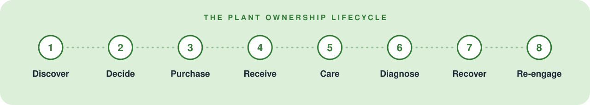
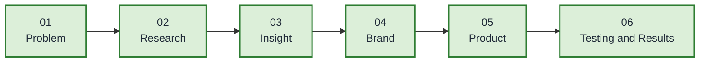

 

# Nabta — Grow with Confidence

**An end-to-end product design case study for a more connected plant ownership experience.**

 

 

[The Problem](#the-problem) · [Key Insight](#the-key-insight) · [Research](#research-and-discovery) · [Approach](#design-approach) · [Brand](#brand-identity-and-design-system) · [Product](#the-product-experience) · [Testing](#usability-testing-and-iteration) · [Pricing](#transparent-pricing) · [Resources](#project-resources) · [About](#about-the-designer)

 

Nabta explores how digital product design can support the entire plant ownership journey, from discovering the right plant to maintaining its health long after purchase.

> [!TIP]
> The project reframes plant shopping as the beginning of a relationship, not the end of a transaction.

## Project Overview

| | Details |
|---|---|
| **Role** | Product Designer |
| **Platform** | Mobile Application |
| **Focus** | UX Research, UI Design, Product Strategy, Design Systems |
| **Tools** | Figma, FigJam, Notion |
| **Research Participants** | 28 survey participants |
| **Lifecycle Stages** | 8 |
| **Core Tasks Tested** | 6 |
| **User Flows Mapped** | 4 |

## The Problem

### Buying a plant is easy. Keeping it alive isn't.

Beginner plant owners often rely on disconnected sources such as social media, stores, search engines, and memory to choose plants and care for them.

Although each source may provide useful information, the overall experience can feel fragmented. Choosing a suitable plant is only one part of a longer journey involving delivery, daily care, diagnosis, and recovery.

> [!IMPORTANT]
> **The design challenge:** How might we create an experience that helps people choose the right plant and continues supporting them throughout ownership?

## The Key Insight

### Ownership is the product. Shopping is a step.

Journey mapping shifted the focus from the purchase itself to the complete plant ownership lifecycle.

Nabta was designed around eight connected stages:

**Discover → Decide → Purchase → Receive → Care → Diagnose → Recover → Re-engage**

This perspective informed the product structure, the organization of key features, and the design of the core user journeys.

## Research and Discovery

The research phase explored user needs, existing solutions, and opportunities to improve the plant ownership experience.

Research activities included:

- User survey with 28 participants.
- Competitive analysis of existing plant-related experiences.
- Journey mapping across the plant ownership lifecycle.
- Identification of recurring pain points and design opportunities.

The resulting design direction emphasized plant suitability, clear purchasing information, accessible care guidance, and recovery support.

> [!NOTE]
> *The sample was limited and directional; findings should not be interpreted as representative of all plant owners.*

## Design Approach

<b>Expand the six steps</b>

 

| Step | Stage | What it means |
|:---:|---|---|
| **01** | **Problem** | Identify the disconnect between purchasing a plant and successfully caring for it over time. |
| **02** | **Research** | Explore user behaviors, expectations, and existing alternatives to understand where the experience breaks down. |
| **03** | **Insight** | Reframe the product around plant ownership rather than treating shopping as the primary destination. |
| **04** | **Brand** | Develop a calm, natural, and trustworthy visual identity supported by consistent interface patterns. |
| **05** | **Product** | Translate the research direction into user flows, information architecture, plant discovery, product details, and profile experiences. |
| **06** | **Testing and Results** | Use observed user behavior and feedback to identify opportunities for improving navigation, information hierarchy, and feature discoverability. |

## Brand Identity and Design System

The visual identity combines organic cues with a structured interface to create an experience that feels approachable, clear, and trustworthy.

### Color Palette

<b>View the palette as a table</b>

 

| Token | Color | Hex |
|---|---|---|
| Forest Green | Primary | `#2E7D32` |
| Leaf Green | Secondary | `#66BB6A` |
| Soft Sage | Surface | `#DCEFD9` |
| Warm White | Background | `#FAFAF7` |
| Charcoal | Text | `#1F2937` |
| Muted Gold | Accent | `#F9A825` |
| Terracotta Red | Error | `#D32F2F` |
| Info Blue | Information | `#0288D1` |

### Typography

- **Plus Jakarta Sans:** Latin interface typography and wordmark.
- **IBM Plex Sans Arabic:** Arabic interface typography.

The type scale uses a clear hierarchy for display text, headings, body copy, captions, and labels.

## The Product Experience

Nabta's core mobile experience includes five key areas:

| Area | Purpose |
|---|---|
| **Welcome** | Introduces the product and establishes the first impression. |
| **Discover** | Helps users explore plants and personalized recommendations. |
| **Shop** | Supports browsing and filtering. |
| **Plant Details** | Brings plant suitability, care information, and total price together to help users make informed decisions. |
| **Profile** | Organizes orders, wishlist items, and settings. |

> [!IMPORTANT]
> A key design decision was to present suitability, care information, and total cost together on the plant details screen, helping users evaluate whether a plant fits their needs before committing.

## Usability Testing and Iteration

Testing highlighted opportunities to improve the experience at important moments in the plant ownership journey.

<b>Observations and design responses</b>

 

| Area | Observation | Design Response |
|---|---|---|
| Discovery | Users explored before searching. | Increase the visibility of exploration. |
| Plant Details | Users scanned for care information. | Introduce a concise care summary. |
| Checkout | Users checked the total cost. | Provide a transparent price breakdown. |
| My Plants | Users expected purchases to appear in their plants experience. | Connect order completion with ownership. |
| Diagnosis | Users were unsure where to start. | Introduce a clear “Something's Wrong” entry point. |

> [!NOTE]
> These decisions reflect the project's usability observations and intended design responses. Quantitative improvements should only be reported when supported by measured results.

## Transparent Pricing

Nabta explores showing the complete cost before the final purchase decision.

**Example breakdown**

| Item | Amount |
|---|---:|
| Plant | 500 EGP |
| Delivery | 50 EGP |
| Fees | 25 EGP |
| **Total** | **575 EGP** |

This design decision aims to reduce uncertainty and help users understand the full cost upfront.

## What I Would Measure Next

<b>Future evaluation could examine</b>

 

- Plant discovery and selection task completion.
- Time required to identify a suitable plant.
- Comprehension of plant care requirements.
- Checkout completion and pricing clarity.
- Engagement with care reminders.
- Users' ability to identify appropriate recovery actions when a plant has a problem.

> [!NOTE]
> These are proposed evaluation measures, not reported outcomes.

## Project Resources

  
  

- **Behance:** [View my work](https://www.behance.net/gallery/257241891/Nabta-Mobile-App-UXUI-Design-Case-Study)
- **LinkedIn:** [Connect with me](https://lnkd.in/p/ekJZp3Hc)

## About the Designer

I'm Abrar Ayman, a Product Designer based in Alexandria, Egypt.

I design end-to-end digital experiences, connecting UX research, information architecture, interaction design, and design systems to create thoughtful, user-centered products.

My work focuses on understanding the problem behind the interface and designing experiences that remain useful beyond the first interaction.

## Future Opportunities

Further work could explore more personalized plant recommendations, improved long-term care guidance, and additional validation of the ownership experience across different plant types and user needs.

**Nabta — Grow with Confidence.**

*An independent product design case study exploring the full plant ownership journey.*

<a href="#nabta--grow-with-confidence">Back to top</a>

